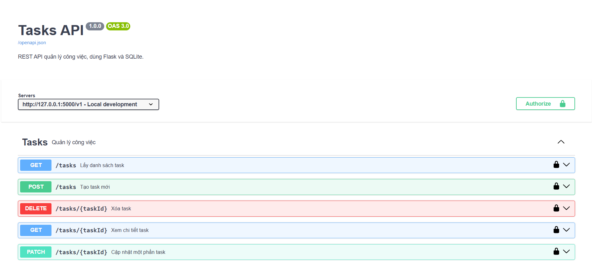
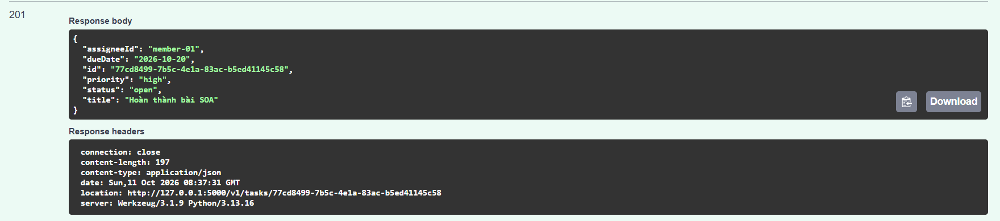

# Week 4 - Tasks API (OpenAPI Specification & Swagger UI)

REST API quản lý công việc (Tasks) sử dụng Flask và SQLite, tuân thủ đặc tả chuẩn OpenAPI 3.0.3. Hệ thống cung cấp tài liệu tự động và giao diện kiểm thử qua Swagger UI.

## 1. Hai quyết định thiết kế quan trọng

1. **Sử dụng PATCH thay vì PUT cho việc cập nhật:**
   Một task có nhiều trường dữ liệu, nhưng người dùng thường chỉ cần thay đổi trạng thái (`status`) hoặc độ ưu tiên (`priority`). Việc dùng `PATCH` cho phép client chỉ gửi những trường cần sửa, tránh việc phải gửi lại toàn bộ tài nguyên gây lãng phí băng thông và giảm thiểu rủi ro vô tình ghi đè mất dữ liệu cũ.
2. **Tiếp cận Spec-First với một file đặc tả duy nhất (`openapi.yaml`):**
   Đặc tả API đóng vai trò là "Nguồn chân lý" (Source of Truth). Endpoint `/openapi.json` đọc trực tiếp file này và `/docs` sử dụng nó để dựng Swagger UI. Điều này đảm bảo tài liệu API và mã nguồn triển khai luôn đồng bộ tuyệt đối với nhau.

## 2. Danh sách Endpoints

| Method | Endpoint | Mô tả chức năng |
| :--- | :--- | :--- |
| **GET** | `/v1/tasks` | Lấy danh sách công việc (hỗ trợ phân trang `limit` và lọc `status`). |
| **POST** | `/v1/tasks` | Tạo mới công việc (trả về 201 Created kèm header Location). |
| **GET** | `/v1/tasks/{taskId}` | Xem chi tiết một công việc theo UUID. |
| **PATCH** | `/v1/tasks/{taskId}` | Cập nhật một phần thông tin công việc. |
| **DELETE** | `/v1/tasks/{taskId}` | Xóa công việc khỏi hệ thống (HTTP 204 No Content). |

---

## 3. Minh chứng kiểm thử trên Swagger UI

### 3.1. Giao diện Swagger UI (Đầy đủ 5 thao tác & đã Authorize JWT)

### 3.2. Gọi thử API tạo task (POST /v1/tasks trả về mã 201 Created)
