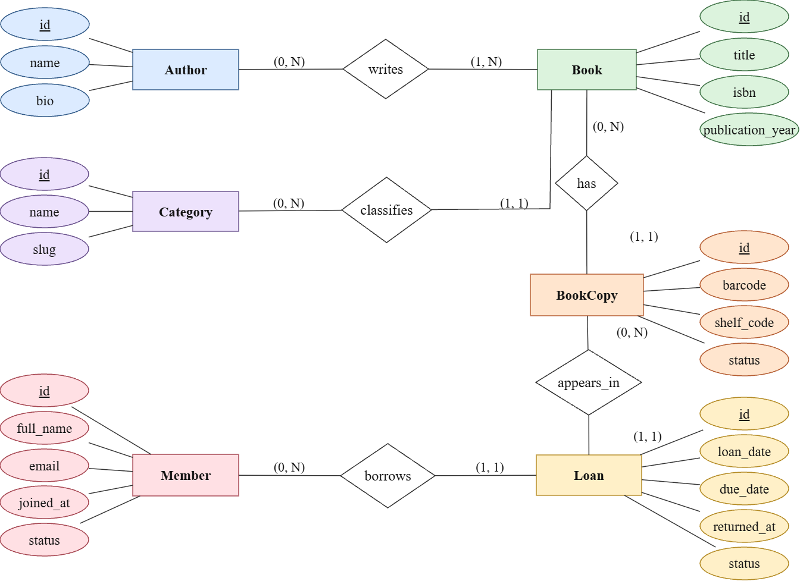

# BÀI TẬP VỀ NHÀ 1 – RESOURCE DESIGN

**Môn học:** Kiến trúc hướng dịch vụ (INT3505E)  
**Sinh viên:** Đào Minh Tuấn  
**Buổi 5:** Data Modeling & Resource Design  
**Đề tài:** Hệ thống quản lý thư viện

## 1. Mô tả bài toán

Thư viện quản lý đầu sách, tác giả, thể loại, các bản sao vật lý của sách, độc giả và phiếu mượn. Một đầu sách có thể có nhiều bản sao; mỗi bản sao chỉ được có một lượt mượn chưa trả tại cùng một thời điểm. Độc giả có thể mượn nhiều sách trong giới hạn cho phép.

## 2. Thực thể và quan hệ

| Thực thể | Thuộc tính chính |
|---|---|
| **Book** | `id`, `title`, `isbn`, `category_id`, `published_at` |
| **Author** | `id`, `name`, `bio` |
| **Category** | `id`, `name`, `slug` |
| **BookCopy** | `id`, `book_id`, `barcode`, `shelf_code`, `status` |
| **Member** | `id`, `full_name`, `email`, `status`, `loan_limit` |
| **Loan** | `id`, `member_id`, `copy_id`, `borrowed_at`, `due_at`, `returned_at`, `status` |
| **BookAuthor** | `book_id`, `author_id`, `role` (bảng liên kết N:M) |

Các quan hệ: **Author N:M Book** (có thuộc tính `role`); **Category 1:N Book**; **Book 1:N BookCopy**; **BookCopy 1:N Loan** (theo thời gian); **Member 1:N Loan**.

### Sơ đồ ERD

## 3. Danh sách REST API

Tiền tố chung: `/api/v1`. Tên resource dùng danh từ số nhiều, chữ thường. ID có dạng `book_42`, `author_3`, `member_7`.

| STT | Method | Endpoint | Chức năng |
|---:|---|---|---|
| 1 | GET | `/books` | Danh sách sách, lọc và phân trang |
| 2 | POST | `/books` | Thêm đầu sách |
| 3 | GET | `/books/{bookId}` | Chi tiết sách |
| 4 | PATCH | `/books/{bookId}` | Cập nhật sách |
| 5 | GET | `/books/{bookId}/copies` | Danh sách bản sao |
| 6 | POST | `/books/{bookId}/copies` | Thêm bản sao |
| 7 | GET | `/books/{bookId}/authors` | Tác giả của sách |
| 8 | POST | `/books/{bookId}/authors` | Gắn tác giả và vai trò |
| 9 | DELETE | `/books/{bookId}/authors/{authorId}` | Bỏ liên kết tác giả |
| 10 | POST | `/authors` | Thêm tác giả |
| 11 | GET | `/authors/{authorId}/books` | Sách của một tác giả |
| 12 | GET | `/categories` | Danh sách thể loại |
| 13 | GET | `/members` | Danh sách độc giả |
| 14 | POST | `/members` | Đăng ký độc giả |
| 15 | GET | `/members/{memberId}` | Chi tiết độc giả |
| 16 | PATCH | `/members/{memberId}` | Cập nhật độc giả |
| 17 | GET | `/loans` | Tra cứu phiếu mượn |
| 18 | POST | `/loans` | Tạo phiếu mượn |
| 19 | GET | `/loans/{loanId}` | Chi tiết phiếu mượn |
| 20 | PATCH | `/loans/{loanId}` | Ghi nhận trả sách |

Ví dụ lọc: `GET /api/v1/loans?member_id=member_7&status=active`. Query parameter dùng **snake_case**; trường JSON dùng **camelCase** như `memberId`, `copyId`, `dueAt`.

## 4. Quyết định thiết kế

- **Nested URL:** `/books/{bookId}/copies` vì bản sao thuộc một đầu sách; `/books/{bookId}/authors` để quản lý liên kết tác giả.
- **Top-level URL:** `/loans` vì phiếu mượn có ID và vòng đời riêng, cần tìm theo độc giả hoặc bản sao.
- **HTTP:** GET trả `200`, POST thành công `201` kèm `Location`, PATCH trả `200`, DELETE trả `204`; dữ liệu sai trả `400`, không tìm thấy trả `404`, xung đột trả `409`.
- **Ràng buộc nghiệp vụ:** Không cho mượn đồng thời cùng một bản sao ở hai phiếu mượn chưa trả. Quy tắc này cần kiểm tra ở tầng xử lý và cơ sở dữ liệu, không chỉ bằng JSON Schema.

## 5. JSON Schema

Ba schema trong thư mục `schemas/` đều sử dụng **JSON Schema Draft 2020-12**:

| File | Nội dung kiểm tra |
|---|---|
| `book.json` | ISBN, tên sách, thể loại, tác giả và số bản còn |
| `member.json` | Email, trạng thái thẻ và giới hạn mượn |
| `loan.json` | ID độc giả/bản sao, ngày mượn – trả, trạng thái và tiền phạt |

Đây là thiết kế tài nguyên và đặc tả dữ liệu, **chưa phải chương trình hiện thực toàn bộ 20 endpoints**.
