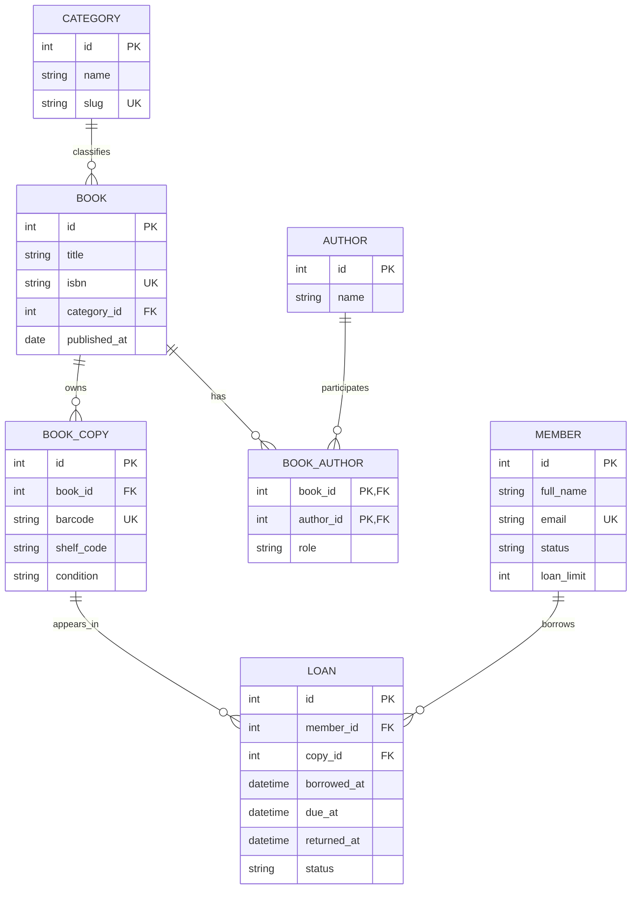

# BÀI TẬP VỀ NHÀ 1 — RESOURCE DESIGN

**Môn học:** INT3505E — Kiến trúc hướng dịch vụ  
**Buổi:** 5 — Data Modeling & Resource Design  
**Miền nghiệp vụ:** Hệ thống quản lý Thư viện (Library Management System)  
**Sản phẩm nộp:** ERD + bảng 16 RESTful endpoints (PDF) và 3 JSON Schemas Draft 2020-12.

## 1. Phạm vi và yêu cầu nghiệp vụ

Thư viện quản lý **đầu sách** (Book), **bản sao vật lý** của sách (BookCopy), tác giả, thể loại, độc giả (Member) và **phiếu mượn/trả** (Loan). Mỗi đầu sách có thể có nhiều bản sao. Một bản sao chỉ được có tối đa **một lượt mượn chưa trả** ở cùng thời điểm; theo lịch sử, một bản sao xuất hiện trong nhiều phiếu mượn. Một độc giả được mượn nhiều bản sao, giới hạn số lượng theo `loanLimit` và trạng thái thẻ. Nhân viên có quyền ghi nhận mượn/trả; client tra cứu đầu sách, tình trạng còn sách và lịch sử mượn.

**Phân biệt mô hình:** `Book` là mô tả đầu sách (ISBN, title), `BookCopy` là từng bản in cụ thể (mã vạch, vị trí, tình trạng); `Loan` là sự kiện nghiệp vụ có vòng đời riêng. Không gộp nhiều BookCopy vào một row Book hoặc nhầm `Loan` với bảng nối N:M thông thường.

## 2. Thực thể, thuộc tính và các mối quan hệ

| Entity | Thuộc tính cốt lõi | Vai trò nghiệp vụ |
|---|---|---|
| **Category** | `id`, `name`, `slug` | Phân loại đầu sách (dùng filter `genre`) |
| **Book** | `id`, `title`, `isbn`, `category_id`, `published_at` | Đầu sách được định danh ổn định |
| **BookCopy** | `id`, `book_id`, `barcode`, `condition`, `shelf_code` | Bản sao vật lý dùng để mượn |
| **Author** | `id`, `name` | Tác giả độc lập, viết nhiều đầu sách |
| **BookAuthor** | `book_id`, `author_id`, **`role`** | Junction N:M, lưu vai trò `lead/co/ed` riêng cho từng cặp |
| **Member** | `id`, `full_name`, `email`, `status`, `loan_limit` | Độc giả, có lịch sử mượn |
| **Loan** | `id`, `member_id`, `copy_id`, `borrowed_at`, `due_at`, `returned_at`, `status` | Phiếu mượn/trả độc lập, tra cứu đa chiều |

**Cardinality và phụ thuộc:**

- Category **1:N** Book — một Book thuộc một Category; Book vẫn là first-class resource (lọc thay vì nest).
- Book **1:N** BookCopy — bản sao không có nghĩa nếu đầu sách bị loại bỏ (strong containment). Vì vậy sử dụng `/books/{bookId}/copies`.
- Book **N:M** Author qua **BookAuthor** — một cặp có `role`; dùng nested + pair endpoint `/books/{bookId}/authors/{authorId}`.
- Member **1:N** Loan — Loan có lifecycle riêng, có thể cần tra cứu từ Member hoặc từ Copy → **top-level** `/loans?member_id=...`.
- BookCopy **1:N theo thời gian** Loan — một bản sao được mượn nhiều lần qua các giai đoạn khác nhau; tối đa 1 loan `active/overdue` tại một thời điểm.

## 3. Sơ đồ thực thể - quan hệ (ERD / Mermaid)



**Bất biến dữ liệu quan trọng:** `UNIQUE(book_id, author_id)`; `UNIQUE(isbn)`, `UNIQUE(barcode)`, `UNIQUE(member.email)`; Loan phải có FK đến một `Member` và một `BookCopy`. Luật "một copy chỉ có tối đa một loan mở" cần kiểm soát giao dịch/unique partial index hoặc locking, **không** thể được đảm bảo chỉ bằng 3 JSON Schemas. `dueAt > borrowedAt` và thời điểm trả hợp lệ cũng là quy tắc nghiệp vụ ngoài schema.

## 4. Danh sách 16 RESTful endpoints

Prefix mặc định: **`/api/v1`**. Các ID dạng `book_42`, `member_7`, `loan_91`, `copy_5`, `author_3`; tên URI có dấu `-` nếu gồm nhiều từ, không chứa động từ; không có extension `.json`.

| STT | Method | URL | Chức năng / dữ liệu |
|---:|---|---|---|
| 1 | GET | `/api/v1/books` | List sách; `?genre=tech&sort=title&limit=20` |
| 2 | POST | `/api/v1/books` | Tạo đầu sách, validate payload → `201 + Location` |
| 3 | GET | `/api/v1/books/{bookId}` | Xem chi tiết một Book (`book_42`) |
| 4 | PATCH | `/api/v1/books/{bookId}` | Sửa metadata sách (không đổi ID) |
| 5 | GET | `/api/v1/books/{bookId}/copies` | Liệt kê bản sao thuộc đầu sách (1:N strong) |
| 6 | GET | `/api/v1/books/{bookId}/authors` | Liệt kê tác giả cùng `role` của cặp Book-Author |
| 7 | POST | `/api/v1/books/{bookId}/authors` | Gắn tác giả và `role` → `201` |
| 8 | DELETE | `/api/v1/books/{bookId}/authors/{authorId}` | Bỏ liên kết cặp → `204` |
| 9 | GET | `/api/v1/members` | Danh sách độc giả, phân trang |
| 10 | POST | `/api/v1/members` | Đăng ký độc giả → `201 + Location` |
| 11 | GET | `/api/v1/members/{memberId}` | Xem hồ sơ độc giả (phải kiểm tra quyền) |
| 12 | PATCH | `/api/v1/members/{memberId}` | Cập nhật liên hệ/trạng thái thẻ |
| 13 | GET | `/api/v1/loans` | Tra cứu phiếu mượn `?member_id=member_7&status=active` |
| 14 | POST | `/api/v1/loans` | Lập phiếu mượn: `memberId`, `copyId`, `dueAt` → `201` |
| 15 | GET | `/api/v1/loans/{loanId}` | Xem một phiếu mượn theo URI độc lập |
| 16 | PATCH | `/api/v1/loans/{loanId}` | Ghi trả: `status=returned`, `returnedAt`; giữ lịch sử |

**Nhất quán contract:** GET thành công 200; POST 201 và `Location`; PATCH 200; DELETE 204; malformed/schema-invalid 400; not found 404; conflict 409; unauthorized 401/403 tùy tình huống. Collection GET có `limit` (mặc định 20, trần 100), hỗ trợ cursor; sort/filter dùng whitelist.

## 5. Áp dụng 7 quy tắc đặt tên từ bài giảng

1. **Plural noun + kebab-case:** `/books`, `/members`, `/loans`; nếu nhiều từ dùng `/book-copies` (không phải `bookCopies`).
2. **Hành động bằng HTTP method:** `POST /loans` để mượn, `PATCH /loans/{id}` để trả; **không** `/borrowBook`, `/returnBook`.
3. **ID ổn định, đồng nhất:** `book_42`, `loan_91`, `member_7`; không dùng title/email làm định danh URI.
4. **Singular chỉ cho singleton thật:** domain này không có singleton, nên dùng collections số nhiều.
5. **Resource tách DB:** không lộ `/tbl_book`, `/book_authors`, FK thô hoặc password hash qua API; junction được thể hiện bằng `/books/{id}/authors`.
6. **Không nhúng file extension:** client yêu cầu JSON bằng `Accept: application/json`.
7. **Không nhúng động từ:** danh từ resource diễn đạt đối tượng; hành động là GET/POST/PATCH/DELETE, không đặt `/add-author` hay `/delete-loan`.

## 6. Nested vs Top-level: quyết định theo vòng đời (slide về decision tree)

| Quan hệ | Quyết định | Lý do |
|---|---|---|
| Book → BookCopy (1:N) | `/books/{bookId}/copies` | Copy phụ thuộc Book (strong containment) |
| Book ↔ Author (N:M) | `/books/{bookId}/authors[/{authorId}]` | Pair có `role`; nested + pair |
| Member → Loan (1:N) | `/loans?member_id=...` | Loan có ID/vòng đời riêng, tra cứu đa chiều |
| BookCopy → Loan (1:N theo thời gian) | `/loans?copy_id=...` (có thể mở rộng) | Loan tồn tại độc lập với đường dẫn điều hướng tới copy |
| Category → Book (1:N) | `/books?genre=tech` | Book tồn tại độc lập, filter phù hợp hơn nested |

**Giới hạn độ sâu:** sâu nhất là hai resource segments (`/books/{bookId}/authors/{authorId}`). Không dùng `/members/{id}/loans/{id}/copies/{id}`.

## 7. JSON Schema cho 3 resource chính

| File | Resource | Ràng buộc tiêu biểu |
|---|---|---|
| `schemas/book.json` | **Book** | `^book_...$`, 13-digit ISBN, `authors` `$defs` + `role`, `copiesAvailable >= 0`, date/date-time |
| `schemas/member.json` | **Member** | Email format, `membershipStatus ∈ {active,suspended,expired}`, `loanLimit ∈ [1,20]`, ISO datetime |
| `schemas/loan.json` | **Loan** | FK dạng prefixed IDs, enum state, `returnedAt` ràng buộc theo status bằng `if/then/else`, `fine` VND không âm |

Cả ba là **JSON Schema Draft 2020-12 cho API response representation** (chứa server-generated ID). Khi implement POST/PATCH sẽ dùng **input schema riêng**: không nhận ID do server sinh, validate `required` phù hợp từng operation. API Book có category/authors embed, Member không lộ mật khẩu/CCCD, Loan chỉ trả liên kết `memberId`/`copyId`, giữ response gọn.

### Ví dụ representation — Book

```json
{
  "id": "book_42", "title": "Clean Code", "isbn": "9780132350884",
  "category": {"id": "category_1", "name": "Technology", "slug": "tech"},
  "authors": [{"id": "author_3", "name": "Robert C. Martin", "role": "lead"}],
  "copiesAvailable": 3, "publishedAt": "2008-08-01", "createdAt": "2026-10-17T08:00:00Z"
}
```

### Ví dụ representation — Member

```json
{
  "id": "member_7", "fullName": "Nguyen Van An", "email": "an@example.org",
  "membershipStatus": "active", "joinedAt": "2026-10-01T09:00:00Z",
  "loanLimit": 5, "activeLoans": 1
}
```

### Ví dụ representation — Loan (đang mượn)

```json
{
  "id": "loan_91", "memberId": "member_7", "copyId": "copy_5",
  "borrowedAt": "2026-10-17T08:00:00Z", "dueAt": "2026-10-31T08:00:00Z",
  "status": "active", "returnedAt": null,
  "fine": {"amount": 0, "currency": "VND"}
}
```

**Lưu ý phân quyền:** endpoints liên quan hồ sơ độc giả và khoản mượn cần authentication/authorization; không cho mọi người dùng đọc hồ sơ Member khác. **Giới hạn bài tập:** đây là thiết kế (ERD, URLs và JSON Schemas), **không** phải implementation của 16 endpoints. Lab1/Lab2 là phần code thực thi của bài học.

## 8. Đối chiếu yêu cầu nộp

- [x] Chọn **Library** trong ba miền bài tập.
- [x] Có **ERD Mermaid** cùng thực thể, FK, PK, cardinality.
- [x] Có **16 endpoints** (thuộc khoảng 12–20 của slide 29), tuân thủ naming và nested rule.
- [x] Có **3 JSON Schemas Draft 2020-12** (Book, Member, Loan).
- [x] Báo cáo có thể xuất PDF để nộp LMS.

*Tài liệu nguồn: “SOA - B5 - Data_Modeling_Resource_Design.pdf”, nội dung resource design, 7 rules, quan hệ N:M, nested decision, representation, JSON Schema và yêu cầu BTVN ở trang cuối.*
