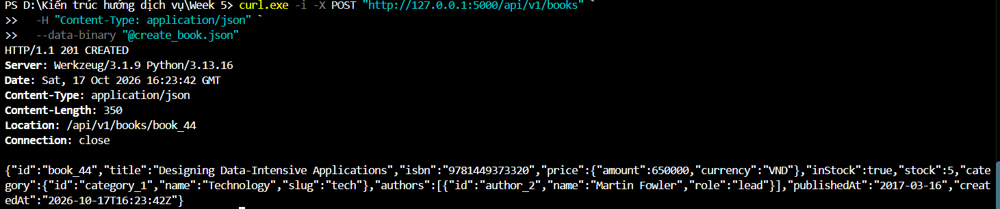
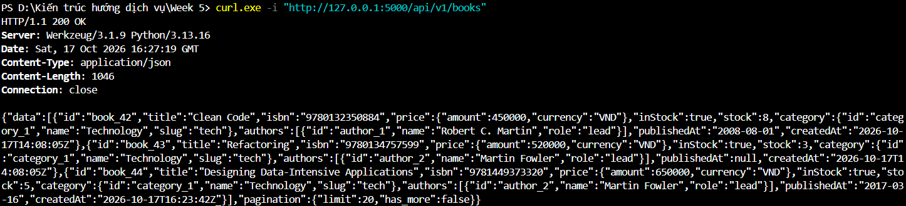
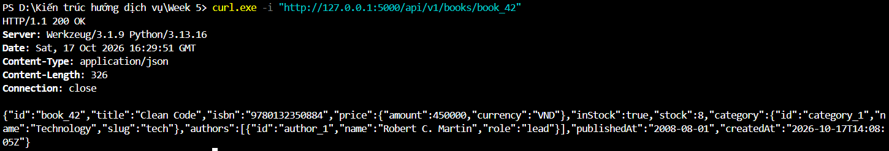
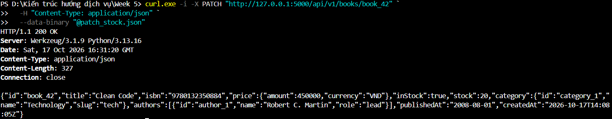
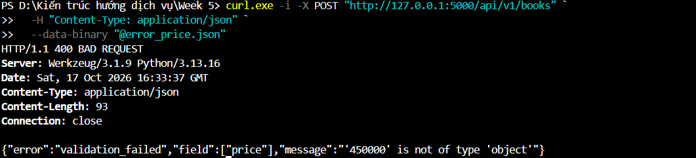
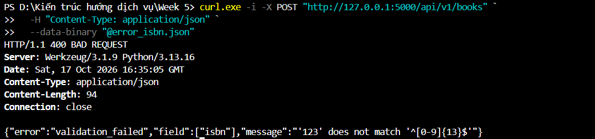
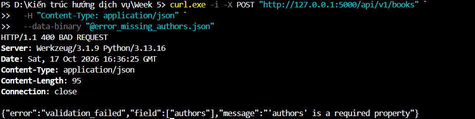
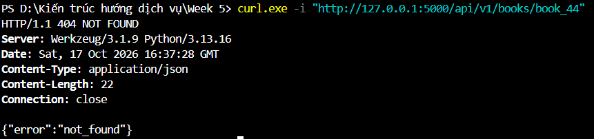

# Lab 1 – Bookstore REST API

**Môn học:** Kiến trúc hướng dịch vụ (INT3505E)  
**Sinh viên:** Đào Minh Tuấn

## 1. Nội dung thực hiện

Xây dựng API quản lý sách bằng Flask và SQLAlchemy, sử dụng SQLite để lưu dữ liệu. Phần dữ liệu gồm Book, Author, Category, User, Review và bảng liên kết BookAuthor.

Request tạo và cập nhật sách được kiểm tra bằng JSON Schema Draft 2020-12. API trả về mã HTTP tương ứng với kết quả xử lý.

## 2. Cách chạy

Tại thư mục `Lab1`:

```bash
python app.py
```

Base URL: `http://127.0.0.1:5000`

| Method | Endpoint | Chức năng |
|---|---|---|
| GET | `/api/v1/books` | Lấy danh sách sách |
| POST | `/api/v1/books` | Thêm sách |
| GET | `/api/v1/books/{id}` | Xem chi tiết sách |
| PATCH | `/api/v1/books/{id}` | Cập nhật sách |
| DELETE | `/api/v1/books/{id}` | Xóa sách |
| GET | `/api/v1/books/{id}/reviews` | Lấy đánh giá |
| GET | `/api/v1/authors` | Danh sách tác giả |
| GET | `/api/v1/categories` | Danh sách thể loại |

## 3. Kết quả kiểm thử

Các request được gửi bằng `curl` trên PowerShell. Ảnh chụp giữ nguyên kết quả trả về của server.

### 3.1. Tạo sách – POST 201

Tạo một Book với thông tin title, ISBN, price, authors và category. Server trả `201 Created` kèm header `Location`.



### 3.2. Lấy danh sách – GET 200

API trả danh sách Book và thông tin `limit`, `has_more`.



### 3.3. Lấy chi tiết – GET 200

Truy vấn một Book theo ID và kiểm tra dữ liệu trả về.



### 3.4. Cập nhật – PATCH 200

Cập nhật trường `stock` mà không cần gửi lại toàn bộ thông tin sách.



### 3.5. Xóa sách – DELETE 204

Xóa Book đã tạo. Server trả `204 No Content`, không có response body.


### 3.6. Kiểm tra JSON Schema

Thử ba request không hợp lệ để kiểm tra phần validation.

**Price sai kiểu:** Truyền chuỗi thay vì object, API trả `400` và chỉ ra trường `price`.



**ISBN sai định dạng:** ISBN không đủ 13 chữ số, API trả `400`.



**Thiếu trường bắt buộc:** Không truyền `authors`, API trả lỗi `validation_failed`.



### 3.7. Book không tồn tại – GET 404

Truy vấn lại `book_44` sau khi đã xóa. API trả `404 Not Found`.



## 4. Nhận xét

Các thao tác CRUD và validation đã được kiểm tra bằng request thực tế. Việc tách JSON Schema khỏi mã nguồn giúp dễ theo dõi các ràng buộc dữ liệu hơn. Phần giới hạn số lượng kết quả được hỗ trợ qua `limit`; các kỹ thuật phân trang nâng cao được thực hiện trong Lab 2.