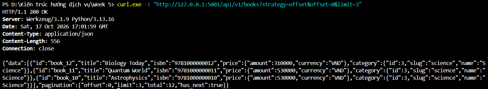
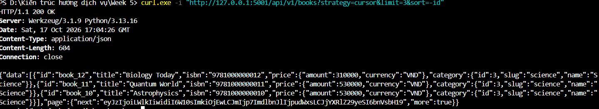
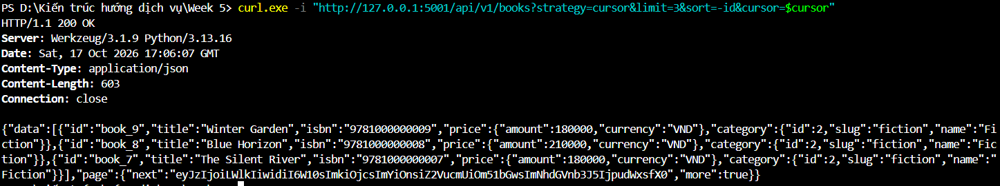
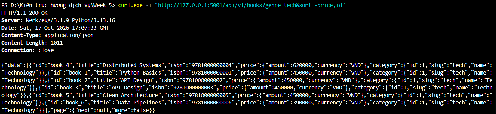
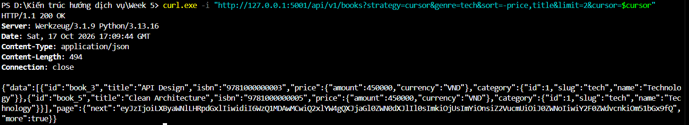
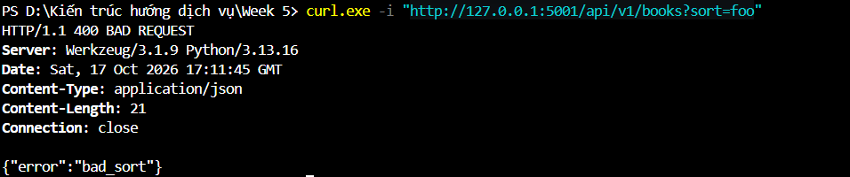
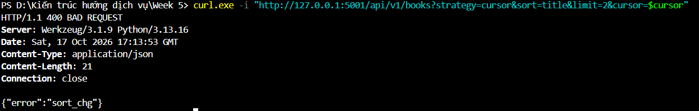
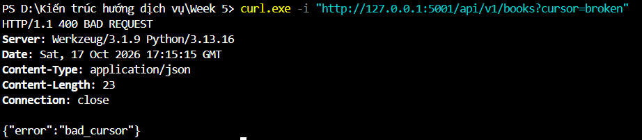

# Lab 2 & BTVN 2 – Pagination và Multi-Key Sorting

**Môn học:** Kiến trúc hướng dịch vụ (INT3505E)  
**Sinh viên:** Đào Minh Tuấn

## 1. Nội dung thực hiện

Lab này tập trung vào truy vấn danh sách sách với hai phương pháp phân trang là Offset/Limit và Cursor-based Pagination.

Ngoài phân trang, API còn hỗ trợ lọc theo `genre`, `category` và sắp xếp theo nhiều trường. Dữ liệu được seed sẵn 12 Book để kiểm thử, trong đó có một số sách trùng giá và tên nhằm kiểm tra cơ chế tie-break.

## 2. Cách chạy

Tại thư mục `Lab2_BTVN2`:

```bash
python app.py
```

Base URL: `http://127.0.0.1:5001`

Các tham số chính của `GET /api/v1/books`:

| Tham số | Ý nghĩa |
|---|---|
| `strategy` | `offset` hoặc `cursor` |
| `offset` | Vị trí bắt đầu khi dùng offset |
| `limit` | Số lượng kết quả, tối đa 100 |
| `cursor` | Token để lấy trang tiếp theo |
| `genre` | Lọc theo slug thể loại |
| `category` | Lọc theo ID thể loại |
| `sort` | Sắp xếp theo `id`, `price`, `title` |

## 3. Kết quả kiểm thử API

### 3.1. Offset Pagination

Request:

```http
GET /api/v1/books?strategy=offset&offset=0&limit=3
```

Server trả 3 Book và khối `pagination` chứa `offset`, `limit`, `total` và `has_next`.



### 3.2. Cursor Pagination – Trang 1

Request:

```http
GET /api/v1/books?strategy=cursor&limit=3&sort=-id
```

Trang đầu gồm `book_12`, `book_11`, `book_10`. Response trả thêm `page.next` để client lấy trang kế tiếp.



### 3.3. Cursor Pagination – Trang 2

Sử dụng token lấy từ trang 1. Kết quả là `book_9`, `book_8`, `book_7`, không trùng với trang trước.



### 3.4. Filtering và Multi-Key Sorting

Request:

```http
GET /api/v1/books?genre=tech&sort=-price,id
```

Chỉ lấy sách thuộc thể loại `tech`, sắp xếp giá giảm dần và ID tăng dần khi trùng giá.



### 3.5. Kiểm tra tie-break khi dữ liệu trùng nhau

Thử phân trang với `sort=-price,title`, `genre=tech`, `limit=2`.

Trong dữ liệu có `book_2` và `book_3` cùng giá và cùng tên. Cursor vẫn chuyển trang đúng vì `id` được dùng làm khóa sắp xếp cuối cùng.



### 3.6. Các trường hợp lỗi

**Sort không hợp lệ:** `sort=foo` trả `400 bad_sort`.



**Thay đổi sort khi dùng cursor cũ:** API trả `400 sort_chg`.



**Cursor không hợp lệ:** `cursor=broken` trả `400 bad_cursor`.



## 4. Unit Test

Chạy:

```bash
python -m unittest -v test_pagination.py
```

Bộ test kiểm tra pagination, filtering, multi-key sorting, xử lý dữ liệu trùng, lỗi tham số và cursor không hợp lệ.

Kết quả lần chạy:

```text
Ran 19 tests in 0.157s

OK
```


## 5. Kiểm thử bằng Postman

File `postman_collection.json` gồm 12 requests. Collection sử dụng biến `baseUrl` trỏ đến `http://127.0.0.1:5001`.

Chạy toàn bộ collection bằng Postman Runner, kết quả:

| Thông số | Kết quả |
|---|---:|
| Requests | 12 |
| Assertions passed | 31 |
| Failed | 0 |
| Errors | 0 |


## 6. Nhận xét

Offset Pagination đơn giản và cho phép truy vấn theo vị trí, nhưng có thể bị ảnh hưởng khi dữ liệu thay đổi giữa các lần lấy trang.

Cursor Pagination sử dụng vị trí của bản ghi cuối trang trước kết hợp các khóa sort. Cách này giúp tránh bỏ sót hoặc lặp bản ghi do trùng khóa sắp xếp trong bộ dữ liệu kiểm thử.

Các trường sort được giới hạn bằng whitelist và truy vấn được xây dựng qua SQLAlchemy, không ghép trực tiếp đầu vào của client vào SQL.

Cursor hiện mã hóa trạng thái bằng Base64 URL-safe, chưa có chữ ký HMAC để chống sửa đổi token. Đây là giới hạn cần xử lý thêm nếu triển khai trong môi trường production.