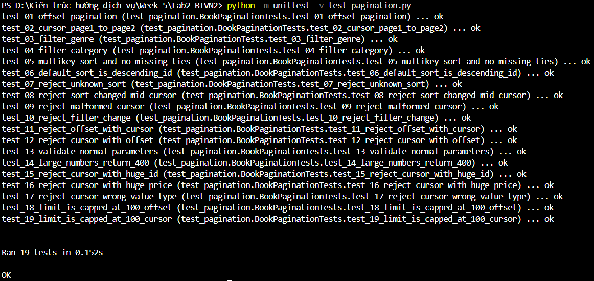
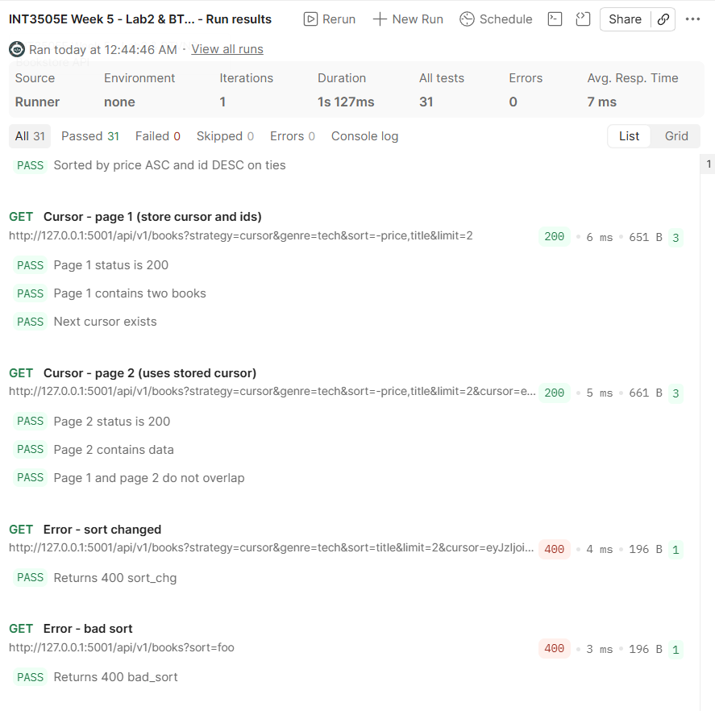

# Tuần 5 – Data Modeling, Resource Design & Pagination

**Môn học:** Kiến trúc hướng dịch vụ (INT3505E)  
**Sinh viên:** Đào Minh Tuấn

Repository gồm các bài thực hành và bài tập về nhà của Buổi 5, tập trung vào thiết kế tài nguyên REST, mô hình dữ liệu, JSON Schema và phân trang API.

## 1. Cấu trúc thư mục

```text
Week 5/
├── Lab1/
│   ├── app.py
│   ├── schemas/book.json
│   ├── images/
│   └── README.md
├── Lab2_BTVN2/
│   ├── app.py
│   ├── test_pagination.py
│   ├── postman_collection.json
│   ├── images/
│   └── README.md
├── BTVN1_Resource_Design/
│   ├── DESIGN_REPORT.md
│   ├── DESIGN_REPORT.pdf
│   └── schemas/
│       ├── book.json
│       ├── member.json
│       └── loan.json
├── requirements.txt
├── .gitignore
└── README.md
```

## 2. Nội dung các bài

| Phần | Nội dung thực hiện |
|---|---|
| Lab 1 | Xây dựng Bookstore REST API bằng Flask, SQLAlchemy và JSON Schema |
| Lab 2 | Thực hành Offset Pagination, Cursor Pagination, filtering và multi-key sorting |
| BTVN 1 | Thiết kế tài nguyên REST cho hệ thống quản lý thư viện, ERD và 3 JSON Schemas |
| BTVN 2 | Hoàn thiện phân trang bằng cursor, xử lý các trường hợp lỗi và kiểm thử tự động |

## 3. Cài đặt và chạy

Cài các thư viện cần thiết tại thư mục `Week 5`:

```bash
pip install -r requirements.txt
```

Chạy Lab 1:

```bash
cd Lab1
python app.py
```

API chạy tại `http://127.0.0.1:5000`.

Chạy Lab 2 từ thư mục `Week 5`:

```bash
cd Lab2_BTVN2
python app.py
```

API chạy tại `http://127.0.0.1:5001`.

Kiểm thử Lab 2:

```bash
python -m unittest -v test_pagination.py
```

## 4. Kết quả thực hiện

**Lab 1:** Đã kiểm tra các thao tác tạo, đọc, cập nhật, xóa sách và các trường hợp JSON không hợp lệ. Có 9 ảnh chụp request/response thực tế.


**Lab 2:** Bộ Unit Test chạy thành công 19 test cases. Postman Collection Runner chạy 12 requests với 31 assertions đạt, không có test thất bại.





## 5. Tài liệu chi tiết

- [Lab 1 – Bookstore API](Lab1/README.md)
- [Lab 2 & BTVN 2 – Pagination](Lab2_BTVN2/README.md)
- [BTVN 1 – Resource Design](BTVN1_Resource_Design/DESIGN_REPORT.md)
- [Báo cáo BTVN 1 (PDF)](BTVN1_Resource_Design/DESIGN_REPORT.pdf)

Các file SQLite và Python cache không được đưa vào bài nộp vì ứng dụng có thể tự tạo lại khi chạy.