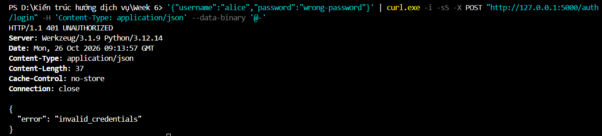
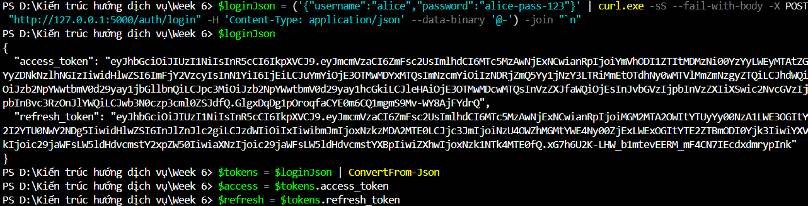
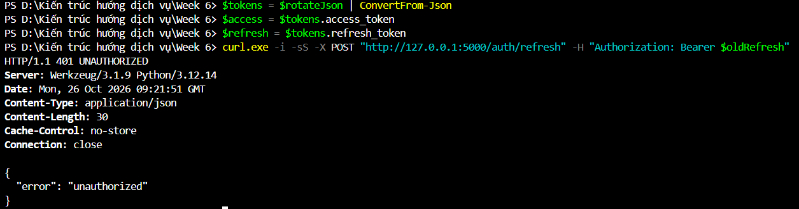
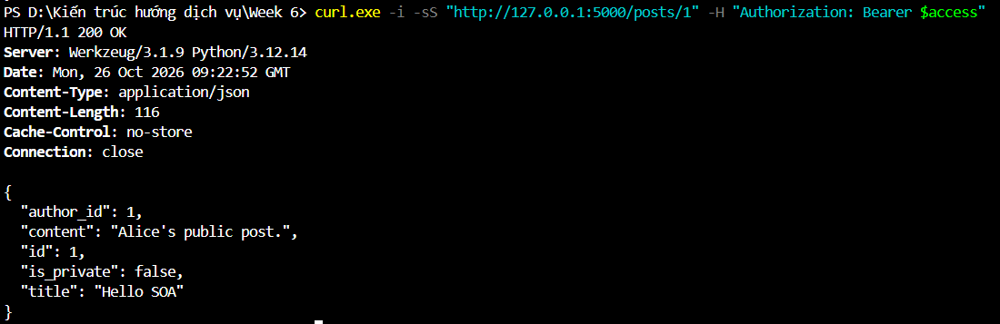
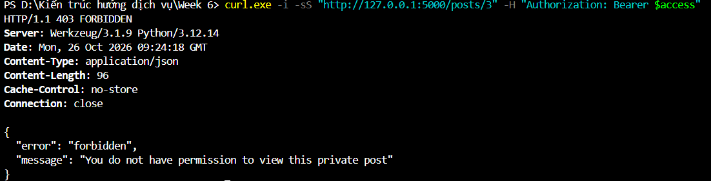

# Social Network API - Tuần 6

- Họ tên: Đào Minh Tuấn
- MSSV: 24021656
- Lớp: 2627I_INT3505E_2
- Học phần: Kiến trúc hướng dịch vụ - INT3505E

## Nội dung

API dùng Flask và JWT, gồm 3 endpoint:

| Endpoint | Chức năng | Yêu cầu |
|---|---|---|
| `POST /auth/login` | Đăng nhập, cấp cặp token | Username/email và mật khẩu |
| `POST /auth/refresh` | Đổi cặp token mới | Refresh token |
| `GET /posts/{id}` | Đọc bài viết | Access token và scope `posts:read` |

Mật khẩu được băm bằng Argon2id. Access token có hạn 15 phút, refresh token có hạn 30 ngày và bị thu hồi sau khi dùng để đổi token.

Khi đọc bài viết, API kiểm tra theo thứ tự: xác thực → scope → quyền sở hữu. Bài public cho phép đọc khi đủ quyền; bài private chỉ chủ bài viết được đọc.

## Cài đặt

Chạy trong PowerShell:

```powershell
cd 'D:\Kiến trúc hướng dịch vụ\Week 6\social-network-api'
python -m venv .venv
.\.venv\Scripts\Activate.ps1
python -m pip install -r requirements.txt
python app.py
```

Server chạy tại `http://127.0.0.1:5000`.

| Tài khoản | Mật khẩu | Scope |
|---|---|---|
| alice | alice-pass-123 | posts:read, posts:write |
| bob | bob-pass-123 | posts:read |

Dữ liệu mẫu: bài 1 public, bài 2 private của Alice, bài 3 private của Bob. Dữ liệu và danh sách thu hồi token được lưu trong RAM, mất khi khởi động lại server.

## Kiểm thử

Mở PowerShell thứ hai:

```powershell
$base = 'http://127.0.0.1:5000'
```

**1. Đăng nhập sai**

```powershell
'{"username":"alice","password":"wrong"}' |
    curl.exe -i -sS "$base/auth/login" -H 'Content-Type: application/json' --data-binary '@-'
```

Kỳ vọng: `401`, lỗi `invalid_credentials`.



**2. Đăng nhập đúng**

```powershell
'{"username":"alice","password":"alice-pass-123"}' |
    curl.exe -i -sS "$base/auth/login" -H 'Content-Type: application/json' --data-binary '@-'
```

Kỳ vọng: `200`, nhận `access_token` và `refresh_token`. Copy hai giá trị vào biến:

```powershell
$access = 'DÁN_ACCESS_TOKEN'
$refresh = 'DÁN_REFRESH_TOKEN'
```



**3. Đổi token**

```powershell
curl.exe -i -sS -X POST "$base/auth/refresh" -H "Authorization: Bearer $refresh"
```

Kỳ vọng: `200`, nhận cặp token mới. Gọi lại bằng refresh cũ sẽ nhận `401`. Cập nhật `$access` và `$refresh` bằng hai giá trị mới.



**4. Đọc bài public**

```powershell
curl.exe -i -sS "$base/posts/1" -H "Authorization: Bearer $access"
```

Kỳ vọng: `200`, trả nội dung bài 1.



**5. Alice đọc bài private của Bob**

```powershell
curl.exe -i -sS "$base/posts/3" -H "Authorization: Bearer $access"
```

Kỳ vọng: `403`, API chặn truy cập và trả:

```json
{
  "error": "forbidden",
  "message": "You do not have permission to view this private post"
}
```



Đặc tả API nằm trong [openapi.yaml](openapi.yaml). Các vấn đề bảo mật được trình bày trong [SecurityAudit.md](SecurityAudit.md).