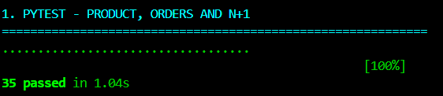
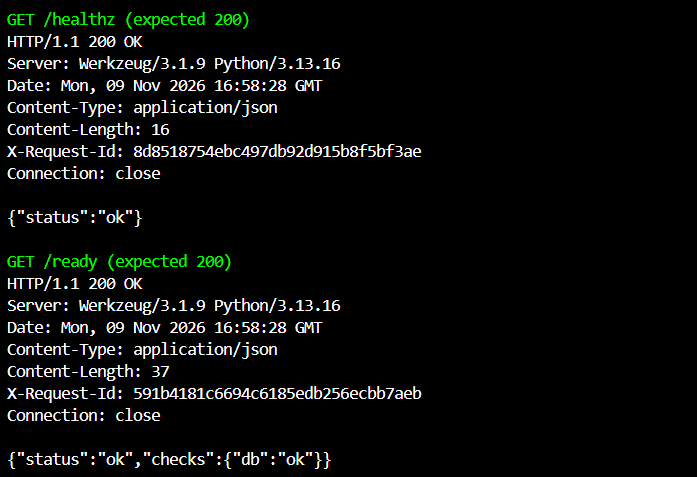
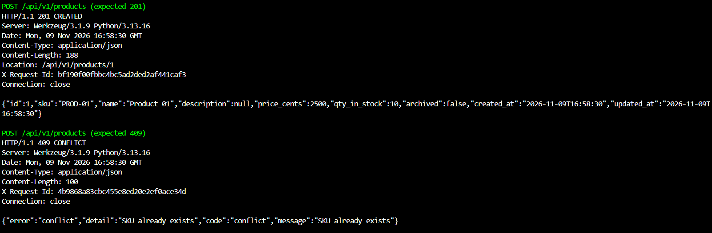
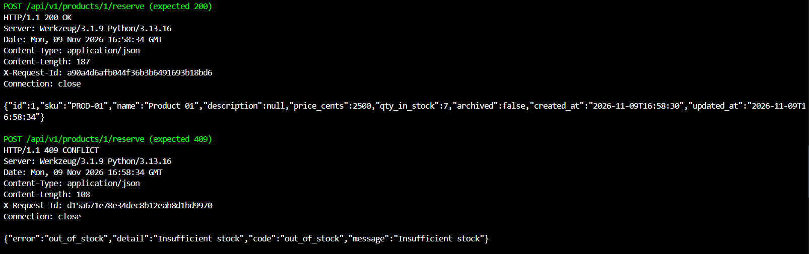
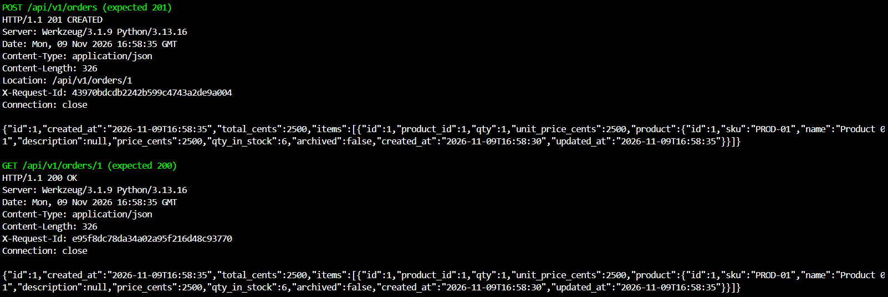

# Báo cáo Thực hành Buổi 7 - Backend Service & RESTful API (Flask, SQLAlchemy 2.x, Docker)

- Họ tên: Đào Minh Tuấn
- MSSV: 24021656
- Lớp: 2627I_INT3505E_2
- Học phần: Kiến trúc hướng dịch vụ - INT3505E

## Nội dung

Service sử dụng Application Factory và các Blueprint riêng cho Health, Products, Orders. Model dùng SQLAlchemy 2.x typed; Marshmallow đảm nhiệm validation và serialization. Order liên kết Product qua OrderItem; `selectinload` tải items và product để tránh N+1. Dockerfile multi-stage chạy ứng dụng với Gunicorn; Docker Compose kết hợp PostgreSQL và job migration.

Product hỗ trợ phân trang, tạo, xem, sửa, soft delete và reserve. Tồn kho được giảm bằng câu UPDATE có điều kiện; Order lưu giá tại thời điểm tạo và rollback toàn bộ nếu một dòng không đủ hàng. Hai endpoint `/healthz` và `/ready` lần lượt kiểm tra liveness và kết nối DB.

## Chuẩn bị minh chứng

Từ PowerShell, chạy một lệnh:

```powershell
cd 'D:\Kiến trúc hướng dịch vụ\Week 7\product-api'
powershell -ExecutionPolicy Bypass -File .\run_curl_tests.ps1
```

Script tạo `.venv` và cài dependency nếu chưa có, chạy pytest, khởi động API riêng trên cổng 5087 với SQLite tạm, rồi lần lượt chạy các lệnh `curl.exe -i`. Chụp từng màn hình khi script dừng và lưu vào `images/` theo tên được in ra; nhấn Enter để tiếp tục. Script xác nhận status và dữ liệu quan trọng, dừng khi có lỗi, sau đó dọn server và DB tạm. Chạy lại không làm thay đổi DB ứng dụng. Cần Python 3.12 hoặc 3.13 trên PATH và kết nối mạng để cài dependency lần đầu. Nếu cổng 5087 bận, dùng `-Port 5088`; chạy không dừng bằng `-NoPause`. Nếu `.venv` đã có nhưng thiếu dependency, chạy `.\.venv\Scripts\python -m pip install -e '.[test]'`.

Các ảnh dưới đây ghi lại kết quả kiểm thử thực tế khi chạy script.

## Minh chứng kiểm thử thực tế (Proof of Work)

### 1. Kiểm thử tự động với Pytest (35 tests passed & Chống N+1)

Mục tiêu: kiểm tra 35 ca, bao gồm tạo sản phẩm, rollback, reserve đồng thời và số truy vấn khi GET orders với 1 và 12 đơn.

```powershell
.\.venv\Scripts\python -m pytest -q
```



### 2. Kiểm tra Health Check Probes (Liveness & Readiness)

Mục tiêu: hai probe trả 200; readiness xác nhận DB hoạt động.

```powershell
curl.exe -i http://127.0.0.1:5087/healthz
curl.exe -i http://127.0.0.1:5087/ready
```



### 3. Tạo sản phẩm mới (201) và Bắt lỗi trùng SKU (409 Conflict)

Mục tiêu: tạo `PROD-01`, tồn kho 10; gửi lại payload để nhận mã `conflict`.

```powershell
$body = '{"sku":"PROD-01","name":"Product 01","price_cents":2500,"qty_in_stock":10}'
[IO.File]::WriteAllText('request.json', $body, (New-Object Text.UTF8Encoding($false)))
curl.exe -i -X POST http://127.0.0.1:5087/api/v1/products -H 'Content-Type: application/json' --data-binary '@request.json'
curl.exe -i -X POST http://127.0.0.1:5087/api/v1/products -H 'Content-Type: application/json' --data-binary '@request.json'
```



### 4. Đặt trước hàng trong kho (Reserve 200 & Out of Stock 409)

Mục tiêu: reserve 3 sản phẩm, tồn kho còn 7; yêu cầu 999 trả `out_of_stock`.

```powershell
[IO.File]::WriteAllText('request.json', '{"qty":3}', (New-Object Text.UTF8Encoding($false)))
curl.exe -i -X POST http://127.0.0.1:5087/api/v1/products/1/reserve -H 'Content-Type: application/json' --data-binary '@request.json'
[IO.File]::WriteAllText('request.json', '{"qty":999}', (New-Object Text.UTF8Encoding($false)))
curl.exe -i -X POST http://127.0.0.1:5087/api/v1/products/1/reserve -H 'Content-Type: application/json' --data-binary '@request.json'
```



### 5. Tạo đơn hàng Order-OrderItem & Eager Loading tránh N+1

Mục tiêu: tạo đơn với product 1 và đọc chi tiết có `items` cùng `product` lồng. Test pytest đếm SQL là bằng chứng kiểm tra N+1; JSON minh họa dữ liệu được tải đầy đủ.

```powershell
[IO.File]::WriteAllText('request.json', '{"items":[{"product_id":1,"qty":1}]}', (New-Object Text.UTF8Encoding($false)))
curl.exe -i -X POST http://127.0.0.1:5087/api/v1/orders -H 'Content-Type: application/json' --data-binary '@request.json'
curl.exe -i http://127.0.0.1:5087/api/v1/orders/1
```



## Khởi chạy ứng dụng

### Python local với SQLite

```powershell
cd 'D:\Kiến trúc hướng dịch vụ\Week 7\product-api'
python -m venv .venv
.\.venv\Scripts\python -m pip install -e '.[test]'
Copy-Item .env.example .env
.\.venv\Scripts\python -m flask --app wsgi:app db upgrade
.\.venv\Scripts\python -m flask --app wsgi:app run --host 127.0.0.1 --port 5000
```

SQLite nằm trong `instance/dev.db`. API tại `http://127.0.0.1:5000`; OpenAPI tại `/openapi.json`, Swagger UI tại `/docs` (asset UI tải từ CDN).

### Docker Compose với PostgreSQL

```powershell
cd 'D:\Kiến trúc hướng dịch vụ\Week 7\product-api'
docker compose up --build -d
docker compose ps -a
docker compose logs api migrate db
```

Compose chờ DB healthy và chạy migration trước khi khởi động API trên cổng 5000. `docker compose down` giữ volume; `docker compose down -v` xóa dữ liệu. Credentials mặc định chỉ dành cho lab. Docker CLI chưa có trong môi trường đã xây dựng dự án, vì vậy cần xác minh Compose trên máy có Docker.
